# Data Architecture, Schema Invariants & PII Minimization (`DATA.md`)

This document defines the complete data architecture of the AI Career Navigator platform, detailing database schemas, relational constraints, entity lifecycles, timezone rules, and strict PII minimization boundaries implemented in the code.

---

## 1. Entity-Relationship Architecture

```mermaid
erDiagram
    users ||--o{ refresh_tokens : "has"
    users ||--o{ password_reset_tokens : "has"
    users ||--o| student_profiles : "owns"
    users ||--o{ user_shortlists : "shortlists"
    users ||--o{ roadmaps : "curates"
    users ||--o{ planner_tasks : "schedules"
    users ||--o{ activity_events : "records"
    users ||--o{ user_milestones : "achieves"
    users ||--o{ weekly_goals : "targets"
    users ||--o{ user_skills : "develops"
    users ||--o{ skill_evidence : "evidences"
    users ||--o| user_portfolios : "publishes"
    users ||--o{ assessment_attempts : "attempts"
    users ||--o{ chat_conversations : "converses"
    users ||--o{ interview_sessions : "practices"

    careers ||--o{ user_shortlists : "included_in"
    careers ||--o{ roadmaps : "structures"
    careers ||--o{ roadmap_templates : "templates"

    roadmap_templates ||--o{ template_phases : "contains"
    template_phases ||--o{ template_items : "contains"

    roadmaps ||--o{ roadmap_phases : "contains"
    roadmap_phases ||--o{ roadmap_items : "contains"
    roadmap_items ||--o{ planner_tasks : "linked_to"

    milestone_rules ||--o{ user_milestones : "awards"
    skills ||--o{ user_skills : "tracks"
    skills ||--o{ skill_evidence : "validates"

    assessment_versions ||--o{ assessment_questions : "contains"
    assessment_versions ||--o{ assessment_attempts : "evaluates"
    assessment_attempts ||--o{ assessment_answers : "records"
    assessment_attempts ||--o| assessment_results : "yields"

    chat_conversations ||--o{ chat_messages : "contains"
    interview_sessions ||--o{ session_questions : "presents"
    session_questions ||--o| interview_answers : "answers"
    interview_sessions ||--o| interview_results : "grades"
```

---

## 2. Core Relational Domains & Tables

### 2.1 Identity & Access Control
- **`users`**:
  Primary user identity. Fields: `id` (UUID), `email` (unique, lowercase), `hashed_password` (argon2id), `role` (`student`, `admin`), `education_level` (`class_11_12`, `college`), `is_active` (boolean), timestamps.
- **`refresh_tokens`**:
  Opaque refresh token store. Fields: `id`, `user_id` (FK CASCADE), `family_id` (UUID for reuse tracking), `token_hash` (SHA-256), `expires_at`, `is_revoked`, `created_at`.
- **`password_reset_tokens`**:
  15-minute one-time tokens. Fields: `id`, `user_id` (FK CASCADE), `token_hash`, `expires_at`, `used`.

### 2.2 Student Profile & Preferences
- **`student_profiles`**:
  Profile metadata. Fields: `id`, `user_id` (FK CASCADE, unique), `name`, `budget_level` (`low`, `medium`, `high`), `hours_available_per_week` (int), `subjects_of_interest` (JSONB array), `skills` (JSONB array of self-reported skills), `timezone` (validated IANA string, default `Asia/Kolkata`), timestamps.

### 2.3 Career Knowledge Graph
- **`careers`**:
  Verified career catalog. Fields: `id`, `code` (unique), `title`, `cluster`, `aliases` (ARRAY), `overview` (text), `salary_ranges` (JSONB), `demand` (`high`, `moderate`, `stable`), `required_skills` (JSONB), `education_paths` (JSONB), `dimension_weights` (JSONB RIASEC 0-100), `status` (`draft`, `verified`), `source_url`, `last_verified_at`, `verified_at`.
- **`skills`**:
  Master skill ontology. Fields: `id`, `slug` (unique), `name`, `category`, `description`, `aliases` (JSONB).
- **`user_shortlists`**:
  Shortlisted careers. Compound PK: `(user_id, career_id)`.

### 2.4 Curriculum Roadmaps & Daily Planner
- **`roadmaps`**:
  User's cloned roadmap copy. Fields: `id`, `user_id` (FK CASCADE), `career_id` (FK CASCADE), `template_version` (int), `title`, `status` (`active`, `completed`, `archived`), `timezone`, `hours_per_week`, `start_date`, `target_completion_date`, timestamps.
- **`roadmap_phases`**:
  Roadmap stages. Fields: `id`, `roadmap_id` (FK CASCADE), `phase_order` (int), `name`, `description`.
- **`roadmap_items`**:
  Individual learning milestones. Fields: `id`, `roadmap_id` (FK CASCADE), `phase_id` (FK CASCADE), `item_code`, `type` (`problem`, `course`, `project`, `reading`), `title`, `estimated_minutes`, `difficulty` (1-5), `topic`, `status` (`todo`, `in_progress`, `done`, `skipped`), `scheduled_week`, `completed_at`, `order_index`.
- **`planner_tasks`**:
  Daily study schedule. Fields: `id`, `user_id` (FK CASCADE), `roadmap_item_id` (FK CASCADE, nullable), `task_type` (`roadmap_item`, `user_custom`, `ai_suggestion`), `title`, `notes` (max 1000 plain text), `estimated_minutes` (1 to 1440), `scheduled_date` (date), `status` (`pending`, `in_progress`, `completed`, `cancelled`), `priority` (`low`, `medium`, `high`), `user_rescheduled` (boolean), `completed_at`, timestamps.

### 2.5 Activity Ledger & Progress
- **`activity_events`**:
  Immutable activity ledger. Fields: `id`, `user_id` (FK CASCADE), `source_type` (`roadmap_item`, `adaptive_test`, `interview_session`), `source_id` (string), `occurred_at` (UTC datetime), `local_date` (date), `tz` (string).
- **`milestone_rules`**:
  Versioned rules. Fields: `id`, `key` (unique), `rule_type` (`event_count_at_least`, `streak_at_least`, `phase_completed`), `params` (JSONB validated by Pydantic), `title`, `version` (int), `active` (boolean).
- **`user_milestones`**:
  Awarded achievements. Fields: `id`, `user_id` (FK CASCADE), `rule_id` (FK CASCADE), `awarded_at`, `evidence` (JSONB).
- **`weekly_goals`**:
  Weekly study targets. Fields: `id`, `user_id` (FK CASCADE), `week_start` (Monday date), `goal_type` (`roadmap_items`, `minutes`), `target` (int), timestamps.

### 2.6 Psychometric Assessment
- **`assessment_versions`**:
  Versioned RIASEC test catalogs. Fields: `id`, `version_number` (unique), `title`, `description`, `is_active`.
- **`assessment_questions`**:
  Individual Holland dimension questions. Fields: `id`, `assessment_version_id` (FK CASCADE), `question_order`, `text`, `dimension` (`R`, `I`, `A`, `S`, `E`, `C`), `reverse_scored`.
- **`assessment_attempts`**:
  Test sessions. Fields: `id`, `user_id` (FK CASCADE), `assessment_version_id`, `status` (`draft`, `completed`), `started_at`, `submitted_at`.
- **`assessment_answers`**:
  Individual question ratings. Fields: `id`, `attempt_id` (FK CASCADE), `question_id` (FK CASCADE), `value` (1 to 5).
- **`assessment_results`**:
  Computed scoring results. Fields: `id`, `user_id` (FK CASCADE), `attempt_id` (FK CASCADE, unique), `version`, `dimension_scores` (JSONB normalized 0-100), `holland_code` (e.g. `IRC`), `holland_code_label`, `traits` (JSONB array), `skills` (JSONB array), `recommended_streams` (JSONB array), `career_suggestions` (JSONB array with AI explanation), `ai_explanation`, `disclaimer_note`.

### 2.7 User Portfolio
- **`user_portfolios`**:
  Public student portfolio. Fields: `id`, `user_id` (FK CASCADE, unique), `slug` (unique, lowercase), `is_public` (boolean), `headline` (max 160), `about` (text), `visibility` (JSONB boolean flags for sections), `featured_item_ids` (JSONB array), `custom_projects` (JSONB array), `custom_certificates` (JSONB array), `competitions` (JSONB array), `achievements` (JSONB array), timestamps.

---

## 3. Critical Schema Invariants & Database Constraints

### 3.1 Compound Uniqueness & Anti-Duplication
1. **Activity Ledger**: `UNIQUE (source_type, source_id)` ensures idempotent insertions via `ON CONFLICT DO NOTHING`. Un-ticking and re-ticking completed items never creates multiple events.
2. **Awarded Milestones**: `UNIQUE (user_id, rule_id)` prevents double-awarding milestones to the same user.
3. **Weekly Goals**: `UNIQUE (user_id, week_start, goal_type)` enforces a single goal per type per week.
4. **Assessment Results**: `UNIQUE (user_id, version)` guarantees immutable version history per student.
5. **Assessment Answers**: `UNIQUE (attempt_id, question_id)` guarantees one response per question per attempt.
6. **Planner Tasks**: Partial unique index `UNIQUE (user_id, roadmap_item_id) WHERE status <> 'cancelled' AND roadmap_item_id IS NOT NULL` guarantees a student cannot schedule multiple active tasks for the same roadmap milestone.

### 3.2 Relational CHECK Constraints
- **Planner Tasks Link Invariant**:
  `CHECK ((task_type = 'roadmap_item' AND roadmap_item_id IS NOT NULL) OR (task_type <> 'roadmap_item' AND roadmap_item_id IS NULL))`
- **Planner Estimated Minutes**: `CHECK (estimated_minutes > 0 AND estimated_minutes <= 1440)`
- **Planner Status**: `CHECK (status IN ('pending', 'in_progress', 'completed', 'cancelled'))`
- **Planner Priority**: `CHECK (priority IN ('low', 'medium', 'high'))`

### 3.3 Cascading Deletion Semantics
- Every user-owned table (`student_profiles`, `assessment_attempts`, `user_shortlists`, `roadmaps`, `planner_tasks`, `activity_events`, `user_milestones`, `weekly_goals`, `user_skills`, `skill_evidence`, `user_portfolios`, `chat_conversations`, `interview_sessions`) enforces `ON DELETE CASCADE` referencing `users.id`.
- Deleting an account immediately and cleanly purges all personal student data without leaving orphaned foreign key records.

### 3.4 Timezone & Date Math Invariants
- **UTC Everywhere at the Datastore**: All `DateTime` columns use PostgreSQL `TIMESTAMP WITH TIME ZONE` and are stored exclusively in UTC (`timezone.utc`).
- **Insertion-Time `local_date` Calculation**:
  `local_date` on `activity_events` is computed at insert time using `ZoneInfo(profile.timezone)`.
- **Historical Invariance**: Changing a student's profile timezone updates subsequent activities, but **never** mutates historical ledger records, preserving historical streak integrity.
- **Rest-Day Allowance Invariant**:
  The streak engine (`current_streak`) considers a streak alive if active today or yesterday. Within an ISO week (Monday to Sunday), a single inactive day is bridged as an allowed rest day without breaking the cumulative streak.

---

## 4. PII Classification & Data Minimization

### 4.1 Data Classification Matrix

| Data Classification | Storage Location | Entity / Columns | Retention & Access Rules |
| :--- | :--- | :--- | :--- |
| **Restricted PII** | PostgreSQL (`users`, `student_profiles`) | `email`, `hashed_password`, `name`, `user_id` | Encrypted in transit; password hashed via argon2id; accessible only to authenticated owner |
| **Protected Academic Data** | PostgreSQL | `assessment_answers`, `dimension_scores`, `test_attempt_answers` | Private to user; never exposed on public routes; excluded from public portfolio projections |
| **Public Portfolio Projection** | PostgreSQL (`user_portfolios`) | `headline`, `about`, `custom_projects`, `certificates`, `competitions`, `achievements` | Accessible to the public via `/v1/portfolio/p/{slug}` only when `is_public=True` and section toggles are enabled |
| **System Audit Ledger** | PostgreSQL | `activity_events`, `user_milestones` | Append-only; zero PII stored in event payloads |

### 4.2 LLM Gateway Data Minimization Boundary
When user context is prepared for AI features (`app/services/chat_context_builder.py` and `app/services/interview_service.py`), the following **strict minimization rules** are enforced:
- **Never Passed to LLM**:
  - Student full names
  - Email addresses
  - Database UUIDs of students or peers
  - Raw unverified profile notes or biographical free-text
  - Raw candidate answer text into follow-up prompts
- **Passed to LLM (Aggregated & Anonymized Only)**:
  - Hours available per week (integer)
  - Subject names of interest
  - Tested skill level names (`intermediate`, `advanced`)
  - Continuous streak count (integer)
  - Bounded rubric criteria boolean detection flags
